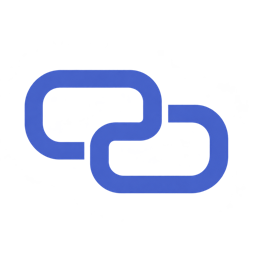
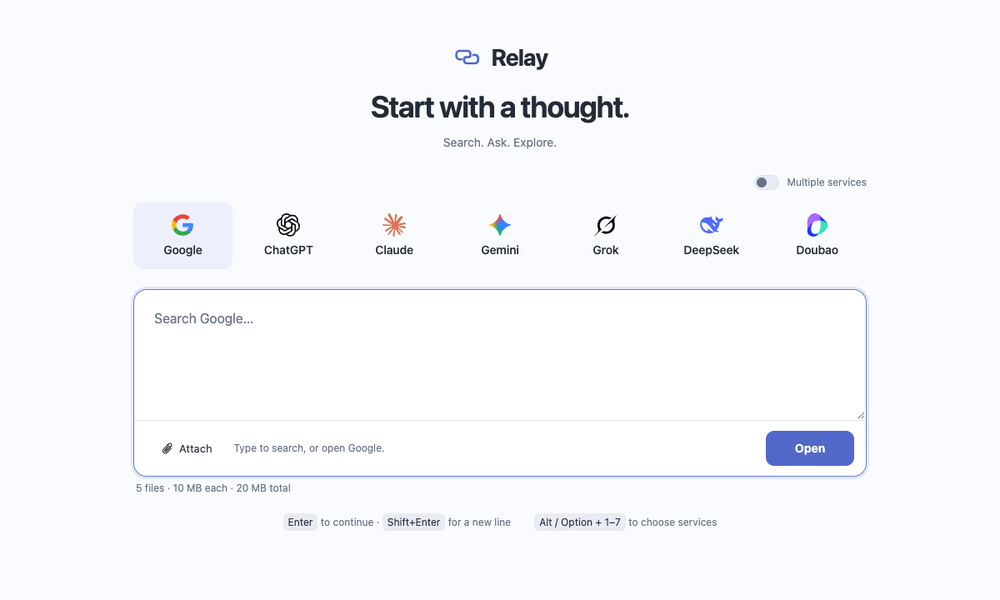

  

<h1 align="center">Relay · Chrome New Tab for AI Search and Chat</h1>

Start with a thought.

  <a href="./README.zh-CN.md">简体中文</a> ·
  <a href="#install">Install</a> ·
  <a href="./PRIVACY.md">Privacy</a> ·
  <a href="./CHANGELOG.md">Changelog</a>

Relay is an open-source Chrome extension that lets you search Google or send the same prompt and attachments to multiple AI chatbots from a new tab. It supports ChatGPT, Claude, Gemini, Grok, DeepSeek, and Doubao. Each service opens in its own browser tab.

## Install

1. [Download the latest master version](https://github.com/algorirhy/relay/archive/refs/heads/master.zip) and unzip it.
2. Open `chrome://extensions` and enable **Developer mode**.
3. Click **Load unpacked** and select the extracted folder containing `manifest.json`.
4. Open a new Chrome tab. You can also pin Relay to the toolbar.

After updating the files, click **Reload** on the extension, refresh any open provider pages, and open a new tab. If another extension replaces the new tab, disable it to use Relay.

## Search Google or start one AI chat

Open a new tab or click Relay in the toolbar. Choose Google for a web search or an AI service for a fresh chat. Enter your text and press **Enter**. An empty draft opens the selected service. The launcher starts in single mode and remembers your last single-service choice.

## Send the same prompt to multiple AI chatbots

Turn on **Multiple services** and choose your destinations. All seven are initially selected. For example, select ChatGPT, Claude, and Gemini, deselect the other destinations, and press **Enter** to ask all three the same question. Read and compare their replies in their respective tabs.

The launcher stays open. Google opens in a new background tab. Chat services start a fresh chat and may reuse a fully loaded tab, with preference for the current window.

### Attachments

Click **Attach**, drop files onto the composer, or paste an image from the clipboard. Relay allows up to **5 files**, **10 MB per file** and **20 MB total**. Supported formats and availability depend on the selected provider. The six chat services also accept file-only drafts when their site supports it.

With files attached, Google uses [Google AI Mode](https://support.google.com/websearch/answer/16011537?co=GENIE.Platform%3DDesktop&hl=en) and requires a question. Without files, Google still uses ordinary web search. Sign in to the selected services before sending.

## Shortcuts

| Where | Shortcut | Action |
| --- | --- | --- |
| Chrome | `Command+Shift+Y` / `Ctrl+Shift+Y` | Open a new Relay tab with its input focused. Customize at `chrome://extensions/shortcuts`. |
| Fresh Relay new tab | `Command+Shift+L` / `Ctrl+Shift+L` | Focus the input in the current tab. Customize at `chrome://extensions/shortcuts`. |
| New tab | `Enter` / `Shift+Enter` | Submit / insert a newline. IME confirmation does not submit. |
| New tab, with page focus | `Option+1–7` / `Alt+1–7` | Select or toggle a service and focus the input. Order: Google, ChatGPT, Claude, Gemini, Grok, DeepSeek, Doubao. |
| New tab, outside editors | `/` | Focus the input. |
| Supported AI website | `Command+Shift+O` / `Ctrl+Shift+O` | Start a new chat. Customize at `chrome://extensions/shortcuts`. |
| Supported AI website | `Command+K` / `Ctrl+K` | Search conversations using the site's command; Gemini is mapped to this shortcut. |

After `Command+T` / `Ctrl+T`, use the focus shortcut before starting a draft. Chrome initially focuses its address bar.

## Delivery and recovery

Each destination runs independently. **Opened Google search** indicates that a tab opened. **Sent to …** indicates that Relay observed signs of submission on the page. Most chat adapters can retry a text-only send once if the draft is unchanged. Doubao and requests with files are submitted at most once. Check the destination before retrying an unconfirmed send.

A failed or interrupted task keeps a temporary draft. If a single delivery fails and the tab is still on the page Relay opened, it returns to the launcher. Files retained in the running background worker are restored for editing and retrying. If the worker has restarted, missing files are marked **(add again)** and must be reselected or removed. If any destination fails, an open launcher keeps the draft and selected files. Review the results before choosing which services to retry. All destinations succeeding clears the composer. **Copy prompt** copies only the text.

If a site's controls are unavailable, check your sign-in and account access, then try the site directly. For Google AI Mode, you can attach files using Google's own controls.

## Do I need AI API keys?

Relay uses your existing browser sign-ins and sends prompts and files through the selected services’ websites. It requires no API keys, build step, or separate Relay account. Relay holds file contents in memory. See [Privacy and permissions](./PRIVACY.md) for what Relay stores to recover drafts.

## Development

See the [development guide](./docs/DEVELOPMENT.md) for architecture, site adapters, tests, and release checks.

[MIT](./LICENSE) · [GitHub](https://github.com/algorirhy/relay)
