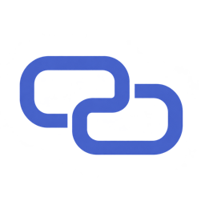
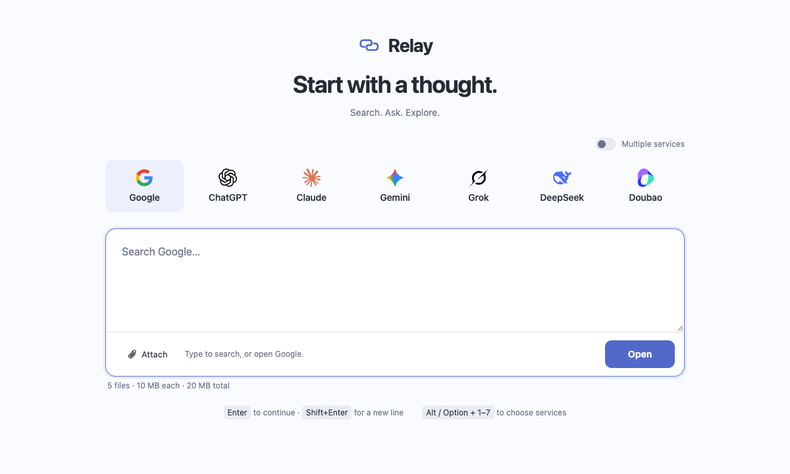

  

<h1 align="center">Relay · Chrome 新标签页的 AI 搜索与对话</h1>

从一个想法开始。

  <a href="./README.md">English</a> ·
  <a href="#安装">安装</a> ·
  <a href="./PRIVACY.md">隐私说明</a> ·
  <a href="./CHANGELOG.md">更新记录</a>

Relay 是一款开源 Chrome 扩展。你可以在新标签页搜索 Google，也可以把同一个问题和附件同时发送给多个 AI。支持 ChatGPT、Claude、Gemini、Grok、DeepSeek 和豆包，各服务在自己的浏览器标签页中打开。

## 安装

1. [下载最新 master 版本](https://github.com/algorirhy/relay/archive/refs/heads/master.zip) 并解压。
2. 打开 `chrome://extensions`，启用**开发者模式**。
3. 点击**加载已解压的扩展程序**，选择解压后包含 `manifest.json` 的文件夹。
4. 打开 Chrome 新标签页。也可以把 Relay 固定到工具栏。

更新文件后，点击扩展的**重新加载**按钮，刷新已打开的服务页面，再打开一个新标签页。如果其他扩展接管了新标签页，请停用该扩展。

## 搜索 Google 或开启单个 AI 对话

打开新标签页，或点击工具栏的 Relay 图标。选择 Google 搜索网页，或选择一个 AI 服务开启新对话。输入文字后按 **Enter**，草稿为空时会直接打开选中的服务。Relay 默认使用单服务模式，并记住上次选中的服务。

## 把同一个问题发送给多个 AI

开启 **Multiple services** 后，可从七个服务中任选，初始全选。比如，只保留 ChatGPT、Claude 和 Gemini，按 **Enter** 就能把同一个问题发给三家，再到各自的标签页比较回答。

启动器保持打开。Google 会在后台新建标签页，聊天服务会开启新对话，优先复用当前窗口中已加载完成的匹配标签页。

### 附件

点击 **Attach**、把文件拖到输入区，或从剪贴板粘贴图片。Relay 最多接收 **5 个文件**，单个不超过 **10 MB**，合计不超过 **20 MB**；可用格式由各服务决定。六个聊天服务在网站允许时也可以只发附件。

有附件时，Google 走 [Google AI Mode（AI 模式）](https://support.google.com/websearch/answer/16011537?co=GENIE.Platform%3DDesktop&hl=zh-Hans)，需要同时输入问题；没有附件时仍使用普通网页搜索。发送前请先登录所选服务。

## 快捷键

| 位置 | 快捷键 | 操作 |
| --- | --- | --- |
| Chrome | `Command+Shift+Y` / `Ctrl+Shift+Y` | 打开一个新的 Relay 标签页并聚焦输入框，可在 `chrome://extensions/shortcuts` 修改。 |
| 刚打开的 Relay 新标签页 | `Command+Shift+L` / `Ctrl+Shift+L` | 在当前标签页聚焦输入框，可在 `chrome://extensions/shortcuts` 修改。 |
| 新标签页 | `Enter` / `Shift+Enter` | 提交 / 换行；输入法选词不会提交。 |
| 新标签页，焦点在页面内 | `Option+1–7` / `Alt+1–7` | 选择服务或切换选中状态，并聚焦输入框。顺序为 Google、ChatGPT、Claude、Gemini、Grok、DeepSeek、Doubao。 |
| 新标签页，输入框外 | `/` | 聚焦输入框。 |
| 支持的 AI 网站 | `Command+Shift+O` / `Ctrl+Shift+O` | 新建对话，可在 `chrome://extensions/shortcuts` 修改。 |
| 支持的 AI 网站 | `Command+K` / `Ctrl+K` | 使用网站的对话搜索命令；扩展为 Gemini 映射此快捷键。 |

用 `Command+T` / `Ctrl+T` 新建标签页时，Chrome 会先聚焦地址栏。在开始写草稿前，可以用聚焦快捷键切到 Relay 输入框。

## 发送结果与恢复

各服务独立处理。**Opened Google search** 表示已打开搜索标签页。**Sent to …** 表示 Relay 在目标页面观察到了提交迹象。多数聊天服务的纯文字发送在草稿原样保留时会重试一次。豆包和带附件的请求最多提交一次。结果未确认时，请先检查目标页面再重试。

失败或中断时会保留临时草稿。单服务发送失败且标签页仍停在 Relay 打开的页面时，会返回启动器。运行中的后台会保留附件，恢复后可修改内容并重试。如果后台已经重启，缺失的文件会标记为 **(add again)**，需要重新选择或移除。只要有一个服务失败，仍打开的启动器就会保留草稿和已选文件。请根据各服务的结果选择要重试的目标。所有服务都成功后会清空输入区。**Copy prompt** 只复制文字。

如果网站没有出现可用的发送或上传控件，请确认已登录、账号可使用该功能，再尝试在网站上操作。Google AI Mode 也可以使用页面自带的附件入口。

## 需要 AI 服务的 API 密钥吗？

Relay 使用浏览器里已有的登录状态，通过所选服务的网页发送问题和附件。无需 API 密钥、构建步骤或单独注册 Relay 账号。附件内容只保留在内存中。草稿恢复会保存哪些数据，见[隐私说明](./PRIVACY.md)。

## 开发

架构、网站适配、测试与发布检查见[开发指南](./docs/DEVELOPMENT.md)。

[MIT](./LICENSE) · [GitHub](https://github.com/algorirhy/relay)
